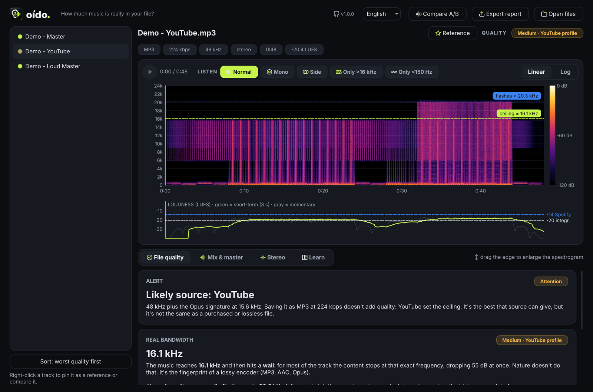
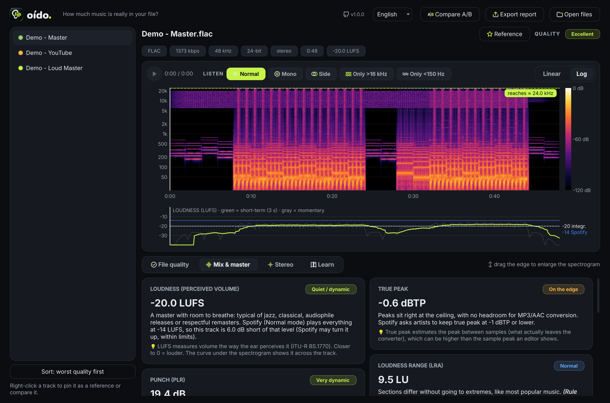
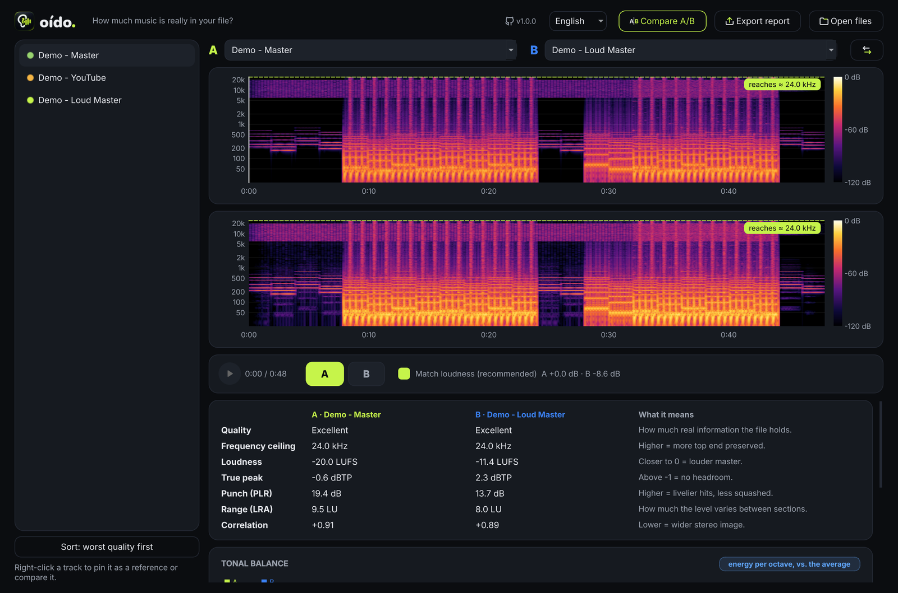
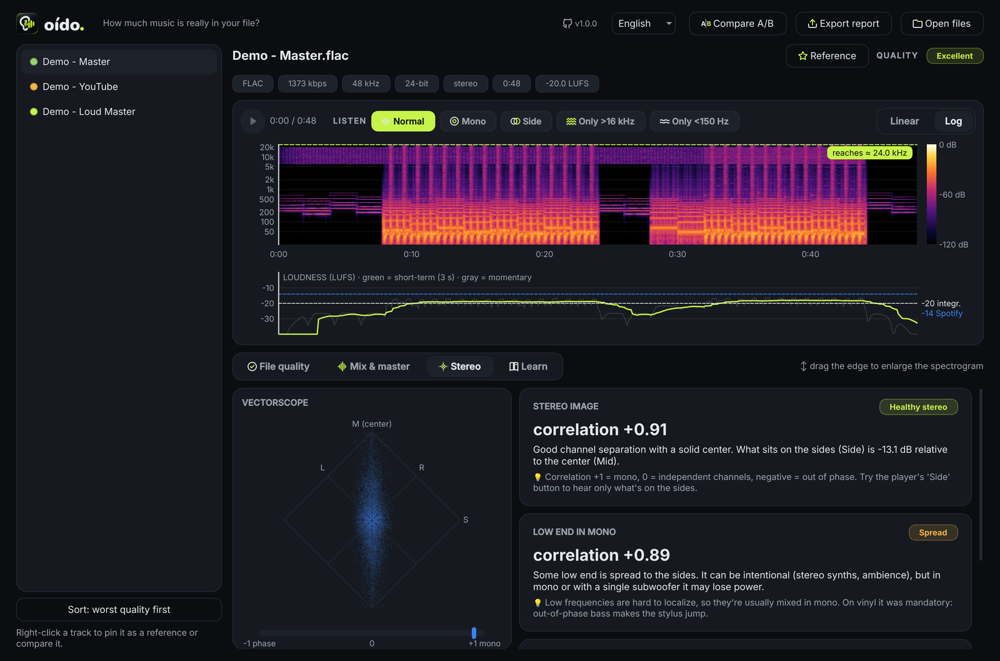

<p align="center">
  <picture>
    <source media="(prefers-color-scheme: dark)" srcset="docs/img/logo_for_dark.png">
    
  </picture>
</p>

<h3 align="center">How much music is really in your file?</h3>

<p align="center">
  Audio quality analyzer for Windows. Spectrogram, upscaled files, loudness, stereo image and A/B comparison,<br>
  explained in plain language for musicians, producers and anyone who listens closely.
</p>

<p align="center">
  <a href="https://github.com/stgermanrobert/oido/releases/latest"></a>
  <a href="https://github.com/stgermanrobert/oido/releases"></a>
  
  
  <a href="LICENSE"></a>
  <a href="https://github.com/stgermanrobert/oido/actions/workflows/build.yml"></a>
</p>

<p align="center">
  <a href="https://github.com/stgermanrobert/oido/releases/latest"><b>⬇&nbsp; Download for Windows</b></a>
  &nbsp;·&nbsp; <a href="#how-it-works">How it works</a>
  &nbsp;·&nbsp; <a href="#development">Development</a>
</p>

<p align="center"></p>

## Why it exists

An MP3 labeled **320 kbps** can hold the quality of a **128**. A **FLAC** can be made from an MP3. Anything ripped from **YouTube** has a treble ceiling no converter can restore. The number on the label tells you none of that. **The content does.** Oído reads the content, shows it to you and explains what you are looking at.

## Features

**File quality**
- **Spectrogram** on a **linear** scale (to spot codec cutoffs) and a **logarithmic** one (to read music), with time zoom.
- Measures the **real frequency ceiling** frame by frame and tells an **encoder cutoff** (a straight "wall") apart from a recording's **natural roll-off**.
- Flags **upscaled files** (a 320 made from a 128), **fake lossless** (a FLAC made from an MP3), **fake hi-res** (96 kHz stretched from CD quality), **mono dressed as stereo** and the **YouTube/Opus signature**.

**Mix and master**
- Integrated **loudness** (LUFS, ITU-R BS.1770), with the **curve across the track** and how much Spotify turns it down.
- **True Peak**, **punch (PLR)**, **loudness range (LRA)** and **real clipping** (on lossless files).
- Octave-band **tonal balance** in musical terms: sub, bass, low mids, mids, presence, air.
- **Stereo:** correlation, mono bass, width per band and a live **vectorscope**.

**Listen to understand**
- Player with **Mono**, **Side**, **Only >16 kHz** (what a bad MP3 throws away) and **Only <150 Hz** modes.
- **Loudness-matched A/B comparison**, the golden rule of mastering: louder always sounds better, so Oído takes volume out of the equation.
- **References:** keep the tracks you trust and compare anything against them.

**Workflow**
- Drop files or whole folders, sort by **worst quality first** and **export a CSV report** that opens straight in Excel.
- Right-click an audio file in Windows → **Analyze with Oído** (optional during setup).
- Interface in **English, Spanish and Russian**, switchable from the header.
- Works with **[Morph](https://github.com/stgermanrobert/morph)**, its sister app for converting and downloading.

<table>
  <tr>
    <td></td>
    <td></td>
  </tr>
  <tr>
    <td align="center"><sub>Mix and master · log scale and loudness curve</sub></td>
    <td align="center"><sub>Loudness-matched A/B: dynamic master vs. "loudness war"</sub></td>
  </tr>
  <tr>
    <td></td>
    <td></td>
  </tr>
  <tr>
    <td align="center"><sub>Stereo · vectorscope and correlation</sub></td>
    <td align="center"><sub>Quality · a 16 kHz ceiling with flashes above it: the YouTube signature</sub></td>
  </tr>
</table>

<sub>Screenshots use a synthetic demo track generated in code, free of third-party rights.</sub>

## Download and install

1. Get **`Oido-Setup-x.y.z.exe`** from [Releases](https://github.com/stgermanrobert/oido/releases/latest).
2. Run it. It installs **for your user only, without admin rights**, with a Start menu entry and an uninstaller. The language you pick in setup becomes the app's language.
3. That's it. **No Python, no FFmpeg, nothing else to install:** everything is bundled.

> **"Windows protected your PC"**: the installer is not signed with a commercial certificate (they are costly and this is an independent project). Click **More info → Run anyway**. Each Release publishes `SHA256SUMS.txt` so you can verify the file, and the full source and build pipeline live in this repository.

Prefer not to install anything? Get **`Oido-x.y.z-portable-win64.zip`**, unzip it and open `Oido.exe`.

## Using it

| Action | How |
|---|---|
| Analyze | Drop files or folders onto the window, or **Open files** (`Ctrl+O`) |
| Play from a point | Click the spectrogram or the loudness curve · `Space` = play/pause |
| Zoom | Mouse wheel over the spectrogram · double-click to see everything |
| Compare | **Compare A/B**, or right-click a track → *Compare with the open track* · `Tab` switches A/B |
| Reference | ☆ **Reference** button, or right-click → *Pin as reference* |
| Review a folder | **Sort: worst quality first**, then **Export report** |
| Language | Language selector in the header (English · Español · Русский) |

The **Learn** tab explains how to read the spectrogram, the vectorscope and every metric.

## How it works

Oído doesn't trust the label: it measures the content. All the analysis lives in [`src/oido_engine.py`](src/oido_engine.py), independent of the interface.

- **Frame-by-frame frequency ceiling.** For every moment it finds how high the signal reaches, relative to that same moment's 500 Hz–4 kHz energy. An encoder **always cuts at the same frequency** with a vertical drop; a natural recording varies and fades out gradually. When the ceilings pile up at one frequency and the drop exceeds 20 dB, that's a codec **wall**.
- **Bitrate equivalents** follow the **LAME** encoder's lowpass table (`optimum_bandwidth()` in `lame.c`): 128 kbps ≈ 17.0 kHz · 192 ≈ 18.6 · 256 ≈ 19.7 · 320 ≈ 20.5. Other encoders cut elsewhere, so this is a guide, not a verdict.
- **YouTube signature.** YouTube serves **Opus audio at 48 kHz**. Opus splits the spectrum into bands, and the top one spans **15.6–20 kHz**; it only gets filled when the treble carries enough energy. The result: a straight line around 16 kHz with flashes above it.
- **Loudness, True Peak and LRA** come from FFmpeg's `ebur128` filter (ITU-R BS.1770 / EBU R128). The Spotify target (−14 LUFS, True Peak ≤ −1 dBTP) comes from its [guidance for artists](https://support.spotify.com/artists/article/loudness-normalization/).
- **Real clipping**: on lossless files it counts runs of 3+ **identical** samples at full scale. On lossy files it can't be measured reliably (the codec rebuilds the waveform), and Oído says so.

> The ranges used to interpret PLR, LRA and correlation are **rules of thumb to orient you, not standards**. Your ears have the final word.

## Development

```powershell
git clone https://github.com/stgermanrobert/oido
cd oido
py -m pip install -r requirements.txt
winget install Gyan.FFmpeg        # only needed to run from source
py src/oido.py
```

**Build the installer locally** (requires [Inno Setup 6](https://jrsoftware.org/isinfo.php)):

```powershell
py -m pip install pyinstaller
py packaging/make_version.py 1.0.0 "Oído" "Audio quality analyzer"
pyinstaller --noconfirm packaging/oido.spec
# copy ffmpeg.exe and ffprobe.exe into dist/Oido/_internal/bin/
& "${env:ProgramFiles(x86)}\Inno Setup 6\ISCC.exe" /DMyVersion=1.0.0 packaging/oido.iss
```

**Translations.** English is the source language; Spanish and Russian live in [`src/locales.py`](src/locales.py). `py tools/i18n_check.py` fails if any string is missing or a placeholder doesn't match, and CI runs it on every build.

**Automated builds.** Every `v*` tag triggers [GitHub Actions](.github/workflows/build.yml) on Windows:
1. Checks that every translation is complete.
2. Builds with PyInstaller and bundles FFmpeg.
3. Runs a **self-test** of the `.exe` (`Oido.exe --selftest`).
4. Builds the installer, then **installs it, tests it and uninstalls it**.
5. Publishes the Release with the installer, the portable ZIP and checksums.

```
src/
  oido.py           interface (PySide6 / Qt 6)
  oido_engine.py    analysis (NumPy + FFmpeg), no UI code
  locales.py        Spanish and Russian catalogs
  i18n.py           language selection and tr()
  ui_icons.py       vector UI icons
  app_runtime.py    paths, bundled FFmpeg, typeface, taskbar icon
packaging/          PyInstaller, Inno Setup, installer artwork
tools/              translation checker
```

## Credits and licenses

Oído source code: **MIT** © 2026 [Germán Robert](https://github.com/stgermanrobert).

Oído is built on [FFmpeg](https://ffmpeg.org), [Qt for Python (PySide6)](https://www.qt.io/qt-for-python), [NumPy](https://numpy.org) and the [Inter](https://rsms.me/inter/) typeface. The installer ships a **GPL** build of FFmpeg as a separate program. Full details in [THIRD_PARTY_NOTICES.md](THIRD_PARTY_NOTICES.md).

<sub>*Oído* is Spanish for "ear".</sub>
